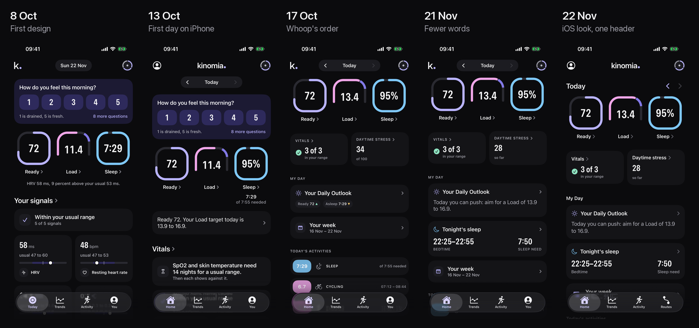
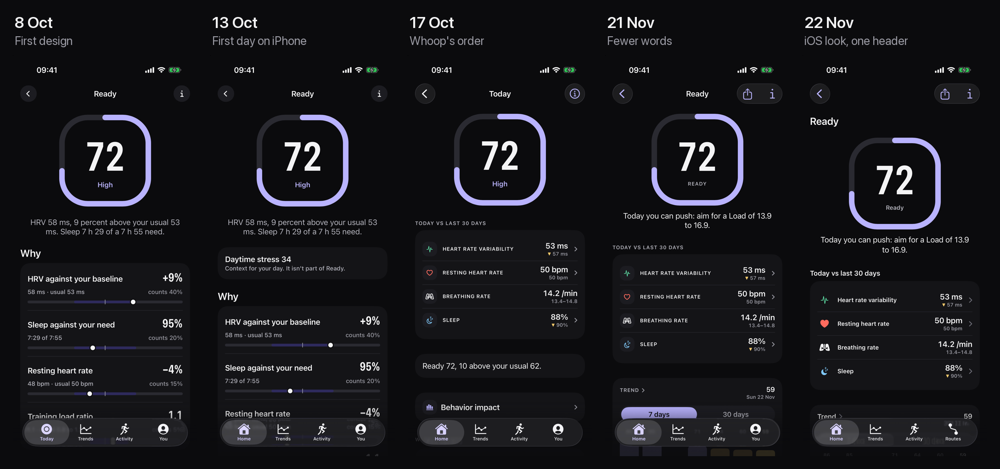
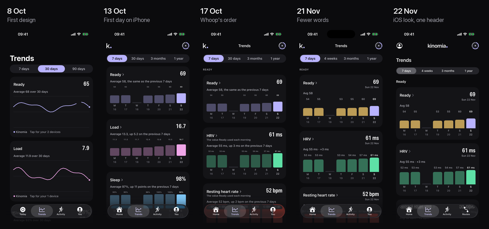
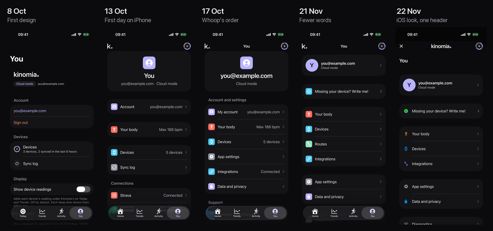

# kinomia: case study

One app for every wearable you own. Three numbers each morning (Ready, Load, Sleep), with your data on your iPhone.

| | |
|---|---|
| Role | Product, design and build, alone |
| Time | 7 weeks, October and November 2026, as a side project next to my full time job at Forte AI |
| Built with | SwiftUI, TypeScript, coding agents (Claude Code) |
| Status | In daily use on my iPhone. Code private, screenshots on made up data |

## Why I built it

I train with a Garmin watch, a Garmin bike computer and an Amazfit strap. That meant three apps, three sets of charts and three names for the same thing, with my data kept in three accounts. I wanted one place, and my data on my phone.

## Vision and focus

The long term idea is one app for people who are healthy and train: devices, training, routes and later food. Route planning on the Mac, a chat about your numbers and TrainingPeaks plans are on the list.

I started with one problem: one place, fed by each device's signals. kinomia reads heart rate, sleep and workouts whoever made the device, so an old watch or a strap with no subscription is still worth wearing.

There's no business model here yet. For now kinomia is for me; taking it to other people is a separate step, and go to market is what I already own at Forte AI.

## Product choices

- Each device is compared with its own history, then kinomia averages them. The morning number shows as soon as one device has synced.
- A workout recorded by two devices shows once. The device's own file wins.
- When two heart rates differ, the chest strap wins over the wrist. kinomia doesn't ask.
- kinomia's numbers come first. Each device's reading is one tap down.
- Everything stays on the iPhone. The server knows only your email address.

## How the design changed

Every change followed the same steps: a written spec, two to six options rendered side by side, one choice, then a week of use. Below, the same four screens on five dates.

### Home

Home is the first screen of the morning, so it changed the most.

The morning check in and the long sentences went. The three dials stayed on top, with one line under them that says what to do today.

### Ready

Tap a dial and you get its page. This is Ready.

It started as a list of weighted factors. Now it's today against your last 30 days, with one line on what to do.

### Trends

Trends shows every number over time.

Lines became bars coloured by level, each one tappable, and the periods grew from 90 days to a year.

### You

You holds your account, your devices and the settings.

It took the layout of the iPhone's own Settings, then lost its coloured tiles, and now opens from the header on every tab.

### What changed and why

| Date | What changed | Why |
|---|---|---|
| 8 Oct | First design: rounded dials, one colour per number, dark only | One look for the app, the site and the dashboard |
| 9 Oct | Cut the screen that compared devices side by side | It was a second problem |
| 13 Oct | One row per device, settings laid out like the iPhone's | On a real iPhone the Garmin showed up twice |
| 17 Oct | Whoop's order: dials, one line, contributors, charts with little text | The right numbers in the wrong order |
| 21 Nov | 151 lines of text cut, one line under each dial | Too many sentences, some numbers shown twice |
| 22 Nov | Apple's system colours, no tiles, sentence case | It read as an Android app |
| 22 Nov | One header on every tab, Routes became a tab | Routes sat three taps deep |

## How it was built

kinomia is a side project, built in the time left around my full time job as chief product officer at Forte AI, so the seven weeks are longer than the same work would take full time. Every decision here is mine. Coding agents wrote the code from my specs, and I reviewed what shipped: about 1,000 commits, 41 merged pull requests and 119,000 lines of Swift, TypeScript and SQL, with 274 test files.

kinomia shows numbers for training and recovery. It isn't a medical device.
