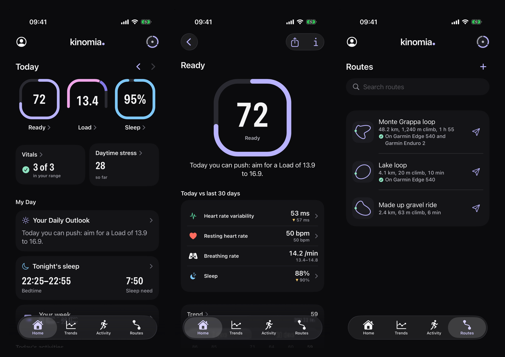
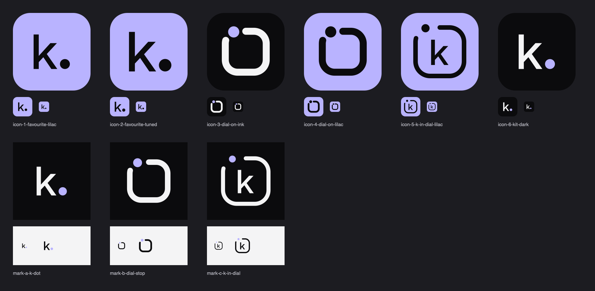
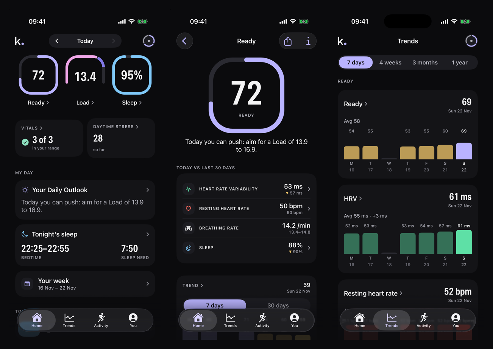
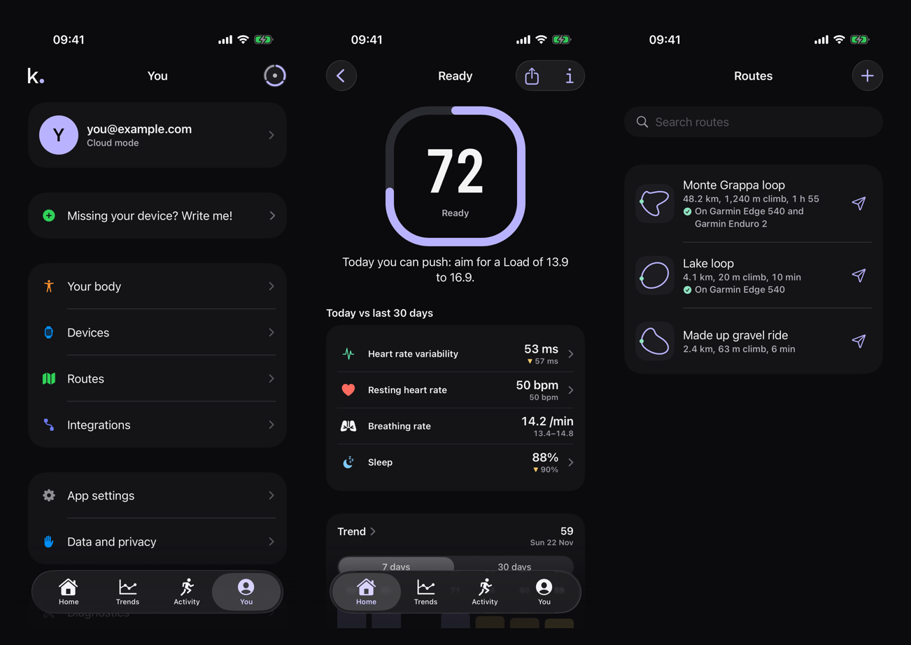
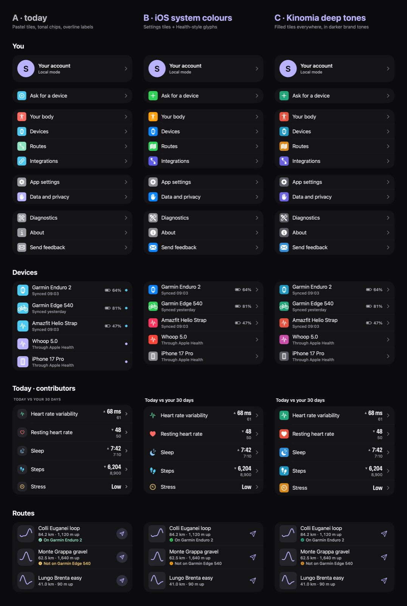
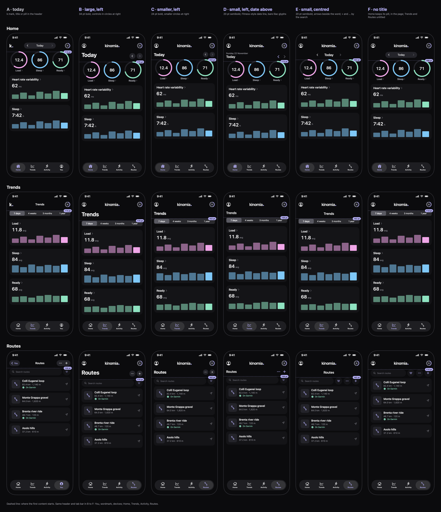

# Kinomia: the product case study

Kinomia is an iPhone app that reads every wearable you own and gives you three numbers each morning: Ready, Load and Sleep. I built it alone in seven weeks, from 4 October to 22 November 2026, for my own training, and I use it every morning. I made every product and design decision in it. This page covers the problem, the vision and the one problem I picked first, the product choices that make it usable and how the design changed along the way, with screenshots of every stage.

The code is private. Every screenshot comes from the app itself, built from the code as it was on that day and opened in its design preview, a mode that fills every screen with made up readings.

Kinomia on 22 November 2026: Home, the Ready page and Routes. The rest of this page is how it got here.

## The problem

I built Kinomia for myself. I train with a Garmin watch, a Garmin bike computer and an Amazfit Helio Strap, and I don't like their apps. Each device has its own app, its own charts and its own name for the same thing, so a simple morning question (how hard can I train today?) took three apps. Garmin Connect also writes to Apple Health late or not at all: on my account it wrote no heart rate to Apple Health from December 2025 to October 2026. I wore a Whoop for a while and stopped because of its subscription; the Amazfit strap does the job for me.

I also want my data with me. The vendors' apps keep it in their own accounts, and the apps that combine wearables keep it on their servers.

## The vision, and the one problem I picked first

The long term idea is one app for people who are healthy, train and want everything in one place: their devices, their training, their routes and, later, what they eat. Route planning inside the app, on the Mac too, a chat where you can ask about your numbers or tell it what you ate, and the training plans from TrainingPeaks next to the readings are on the list. Each of them would be a second problem today, so each waits.

I picked one problem to solve first: one place for everything, fed by each device's signals. Kinomia reads what a device measures (heart rate, heart rate variability, sleep, workouts) and doesn't care who made it. So any device that still records a signal is worth wearing, including an old watch whose app you gave up on, or a strap that doesn't need a subscription.

From that one problem come three goals.

1. Three numbers each morning, Ready, Load and Sleep, from whichever devices have the data, without me deciding which device to trust.
2. The data on time: last night's numbers ready when I wake up.
3. Everything on the phone. The server knows my email address and nothing else.

This page doesn't cover a business model or distribution. For now Kinomia is for me, and taking it to other people is a separate step with its own decisions: who pays, how people find it, where their data lives. I have ideas for that step, and going to market is the part of the job I already own at Forte AI.

## The product choices that make it usable

Each device gets its own Ready, Load and Sleep, compared with that device's own history. Kinomia's number averages them. A night counts only from a device that saw at least four hours of sleep, and Load only from devices that saw at least 80% of the workout's minutes. So the morning number is there as soon as one device has synced, and it can take the night from one device and the heart rate from another.

Kinomia's numbers come first and each device's reading sits one tap down.

A workout recorded by two devices shows once. Kinomia keeps one recording as the main one in a fixed order: the device's own file first, then the vendor's app through Apple Health, then Strava, and the longest when two tie. The others stay under Sources on the workout's page. When two devices disagree on heart rate by more than 10 beats per minute, Kinomia picks one by sensor (a chest strap before a wrist) and doesn't ask. You can still change it on the workout's page, and Kinomia remembers.

Kinomia talks to Garmin, Amazfit and Whoop devices directly over Bluetooth when you choose to, so it doesn't wait for their apps. Apple Health stays the default, because it works with any device on day one.

The data lives in one database on the iPhone, one row per signal, source and day. Sources are never merged in place: a combined value is stored apart, with the inputs it came from. You can export or erase everything from the app.

Every formula has a version number, and each change goes into a changelog the app shows on its methods page. The formulas are written once, in TypeScript, and the iPhone runs that same code, so a number can't differ between the phone and the server.

Strava's rules allow a map to be cached for seven days at most. Kinomia fetches a workout's map when you open it and drops it after 48 hours.

Planned routes from Komoot become courses on the Garmin by themselves.

## The design approach

Every change went through the same steps.

1. A written spec: the problem, the options and what stays fixed. The repository holds 19 of them.
2. Renders of two to six options side by side, on made up data, before the code changed.
3. A choice, written down with its reason.
4. A pull request (a proposed change to the code, reviewed before it goes in), checked in the simulator.
5. A week of use on my iPhone, then the next audit.

A few rules held through every stage. Every sentence on screen carries a number, speaks to you in the second person and makes no medical claim; a test checks every sentence in the app's catalogue for a number and for banned words. The app is dark only, with one lilac accent. Colours, type sizes and spacing live in one file that generates both the app's Swift and the site's CSS.

### 1. The first designed app, 8 October

Today with the morning check in, the share card and You, with the switch that added each device's reading under Kinomia's.

I drew three marks and six app icons and chose a direction I called Quiet instrument: rounded square dials, numbers that line up in columns, one colour per number. The icon is the second one, a tuned version of the lilac k I'd liked from the start.

### 2. One problem at a time, 9 October

Today, Trends and You a day later. On screen the cut is small: the comparison lived in its own screen and cards, and those are gone.

The first spec had a second idea: a screen that compared the devices side by side and showed where they disagreed. A day later I saw it as a loss of focus, a second problem next to the one I'd picked. I cut the Compare screen, its share card and its weekly notification, and each device's reading moved into a closed Sources row at the bottom of each page.

### 3. The first day on a real iPhone, 13 October

Today, Trends and You after the first day on the iPhone: one row per device and You laid out like the iPhone's Settings.

My Garmin showed up twice in the device list, once over Bluetooth and once through Garmin Connect. The list became one row per physical device, each with its own page, and the settings took the layout of the iPhone's own Settings app.

### 4. Whoop's structure, Kinomia's look, 17 October

Home, the Ready page and Trends in Whoop's order: dials, then Vitals and Daytime stress, then My Day.

The app had the right numbers in the wrong order. Whoop has spent years deciding what a person sees first in the morning, so I studied its app screen by screen from five public walkthrough videos, about 735 frames, and wrote down the structure of each screen. I took the order (the dials, one line, the contributors against your last 30 days, charts with little text) and kept our look.

### 5. A month of features, 20 November

Home, the Ready page and You on 20 November, before the cleanup.

A month of daily use added features faster than it removed anything. Most screens carried a sentence explaining how they worked, and some numbers appeared twice on one page.

### 6. A word or a number in place of a sentence, 21 November

Home, the Ready page and Trends: one line under the dial, bars coloured by level.

I cut 151 lines of text from 28 files: no footer explaining a feature, no hint pointing to another screen. Under each dial there is now one line that says what moved the number and what to do, for example "Tonight you need 7:50: be in bed by 22:40."

### 7. It read as Android, 22 November

You, the Ready page and Routes with plain SF Symbols in Apple's system colours and sentence case labels.

The app felt foreign on my own iPhone, and an audit found why: eleven details borrowed from Google's Material design. Pastel tiles under white glyphs (white on lilac has a contrast of about 1.9 to 1), glyphs in grey boxes, uppercase spaced labels, lilac pill toggles and fixed font sizes. I rendered three directions on the same screens.

I chose Apple's system colours and went one step further: no tiles anywhere. Rows draw plain SF Symbols (Apple's icon set), labels are in sentence case and words follow the text size set in iOS.

### 8. One header on every tab, 22 November

Home, Trends and Routes with the same header and titles in the page.

Home showed a k mark that did nothing when tapped, and Routes sat three taps deep although I used it every week. I rendered six title layouts and measured where content starts in each, from 114 to 175 points from the top.

Every tab now has the same header: your profile, the wordmark (it brings you back to today) and your devices. Titles sit in the page. Routes became a tab. A header like this one was already there on 13 October (stage 3); the Whoop restructure replaced it with the k mark, and five weeks of use brought it back with a job to do.

## How it was built

Every decision on this page is mine: the problem, what to fix first, each product rule, the look and the eight redesigns. I wrote the specs, judged every render on my own iPhone, threw away the options that didn't work and reviewed what shipped. The code is written with coding agents (Claude Code) working from those specs, which is how one person could build this much. In seven weeks that came to about 1,000 commits, 41 merged pull requests and about 119,000 lines of Swift, TypeScript and SQL, with 274 test files.

Kinomia shows numbers for training and recovery. It isn't a medical device.
