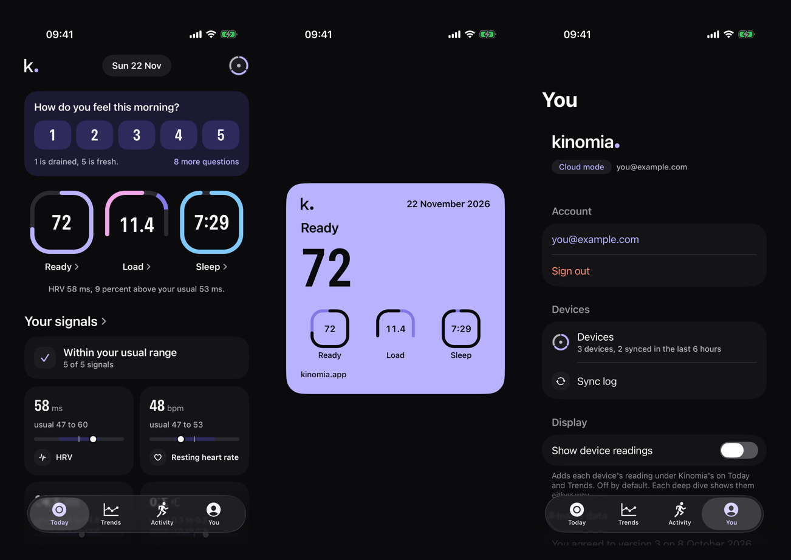
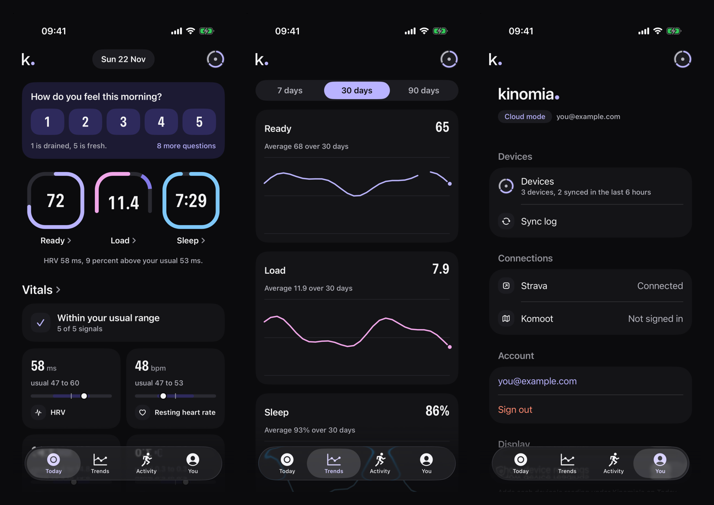
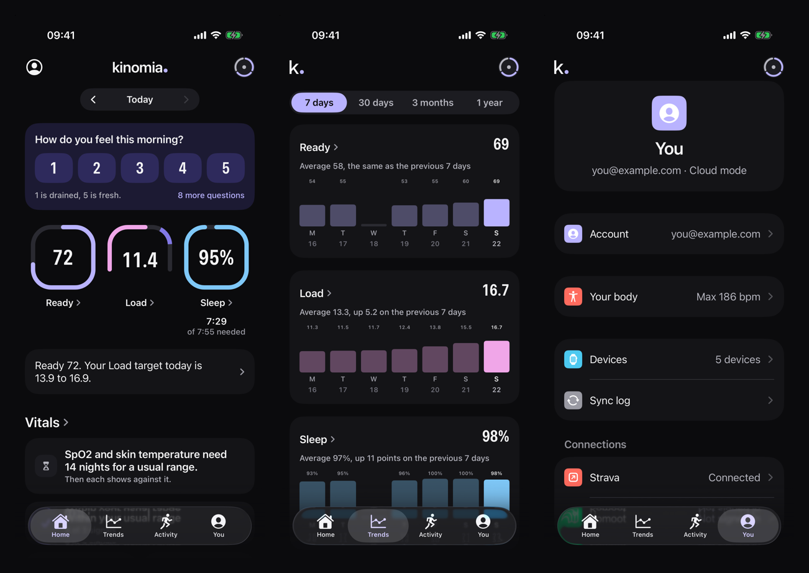
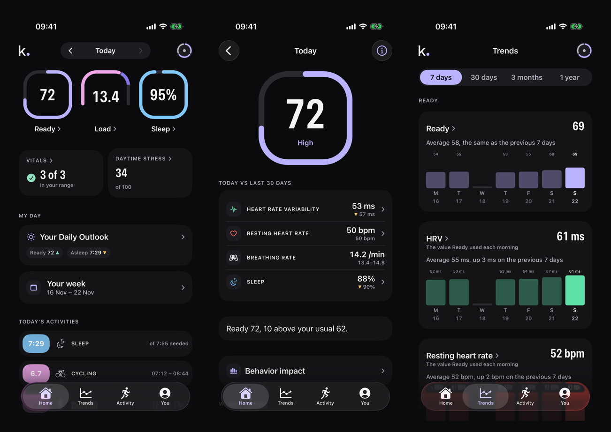
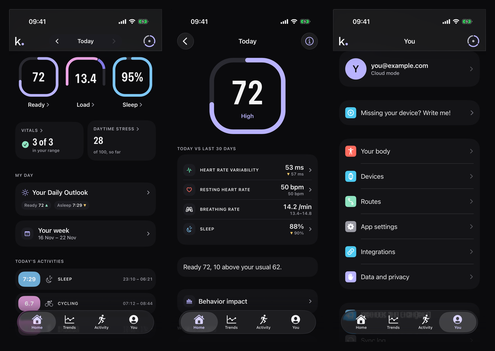
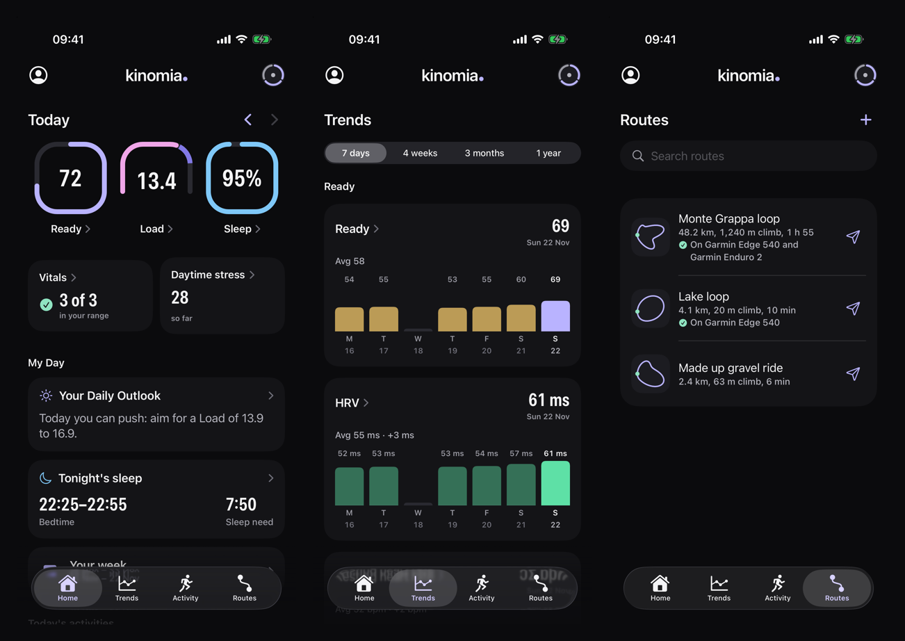

# Kinomia: case study

One app for every wearable you own. Three numbers each morning (Ready, Load, Sleep), with your data on your iPhone.

| | |
|---|---|
| Role | Product, design and build, alone |
| Time | 7 weeks, October and November 2026 |
| Built with | SwiftUI, TypeScript, coding agents (Claude Code) |
| Status | In daily use on my iPhone. Code private, screenshots on made up data |

## Why I built it

I train with a Garmin watch, a Garmin bike computer and an Amazfit strap. That meant three apps, three sets of charts and three names for the same thing, with my data kept in three accounts. I wanted one place, and my data on my phone.

## Vision and focus

The long term idea is one app for people who are healthy and train: devices, training, routes and later food. Route planning on the Mac, a chat about your numbers and TrainingPeaks plans are on the list.

I started with one problem: one place, fed by each device's signals. Kinomia reads heart rate, sleep and workouts whoever made the device, so an old watch or a strap with no subscription is still worth wearing.

There's no business model here yet. For now Kinomia is for me; taking it to other people is a separate step, and go to market is what I already own at Forte AI.

## Product choices

- Each device is compared with its own history, then Kinomia averages them. The morning number shows as soon as one device has synced.
- A workout recorded by two devices shows once. The device's own file wins.
- When two heart rates differ, the chest strap wins over the wrist. Kinomia doesn't ask.
- Kinomia's numbers come first. Each device's reading is one tap down.
- Everything stays on the iPhone. The server knows only your email address.

## How the design changed

Every change followed the same steps: a written spec, two to six options rendered side by side, one choice, then a week of use.

### 8 October · The first design

Rounded dials, one colour per number, a lilac accent, dark only. Three marks and six icons drawn; the lilac k won.

### 9 October · One problem at a time

I cut the screen that compared devices side by side. It was a second problem.

### 13 October · First day on a real iPhone

The Garmin showed up twice, so the list became one row per device. Settings took the iPhone's own layout.

### 17 October · Whoop's order, our look

I studied Whoop screen by screen and took its order: dials, one line, contributors, charts with little text.

### 20 November · A month of features

Daily use added features faster than it removed them. Too many sentences, some numbers shown twice.

### 21 November · Fewer words

151 lines of text cut. Under each dial, one line: what moved it and what to do.

### 22 November · It read as Android

An audit found eleven details from Google's Material design, such as pastel tiles and uppercase labels. I tested three directions and chose Apple's system colours with no tiles.

### 22 November · One header everywhere

Six layouts rendered and measured. The same header on every tab, titles in the page, and Routes became a tab.

## How it was built

Every decision here is mine. Coding agents wrote the code from my specs, and I reviewed what shipped: about 1,000 commits, 41 merged pull requests and 119,000 lines of Swift, TypeScript and SQL, with 274 test files.

Kinomia shows numbers for training and recovery. It isn't a medical device.
