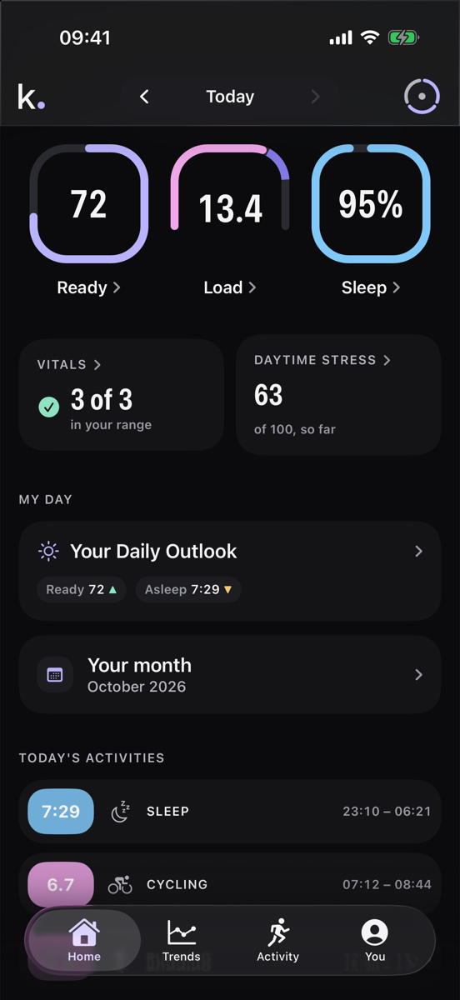
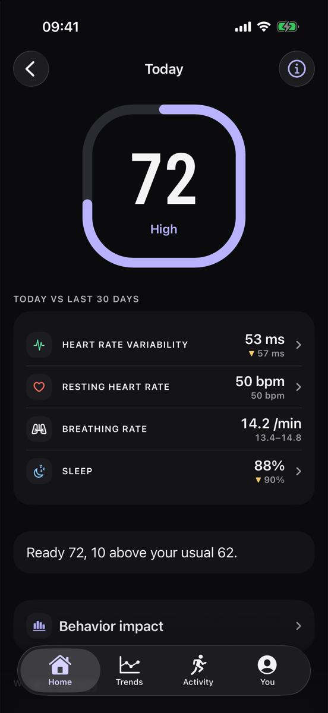
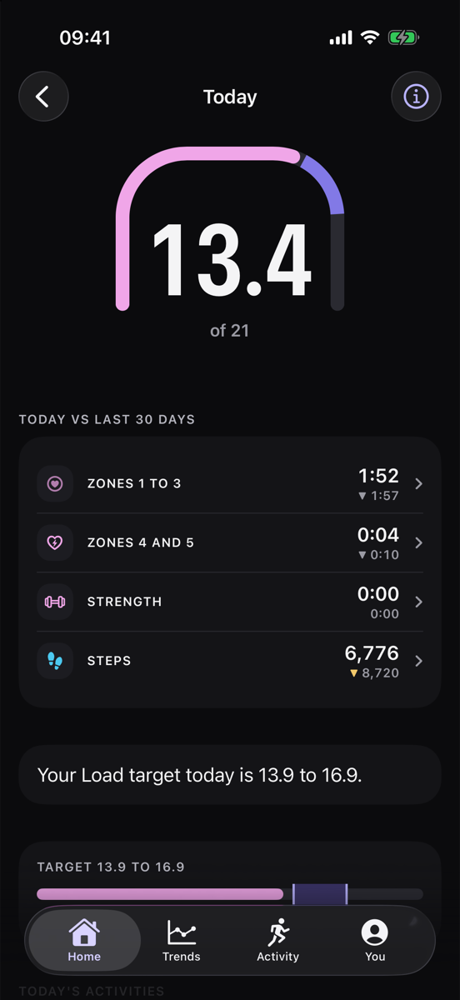
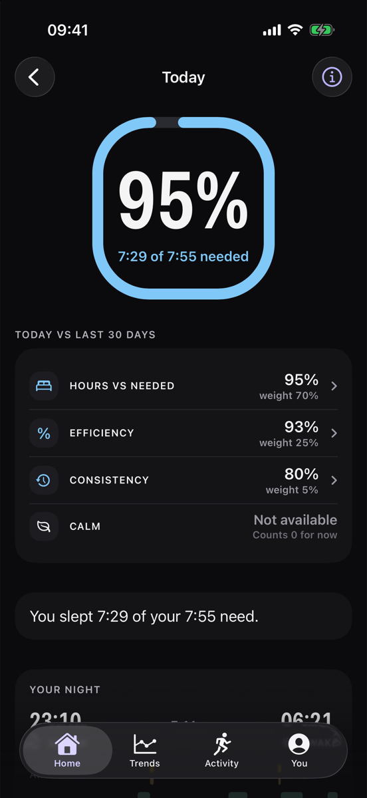
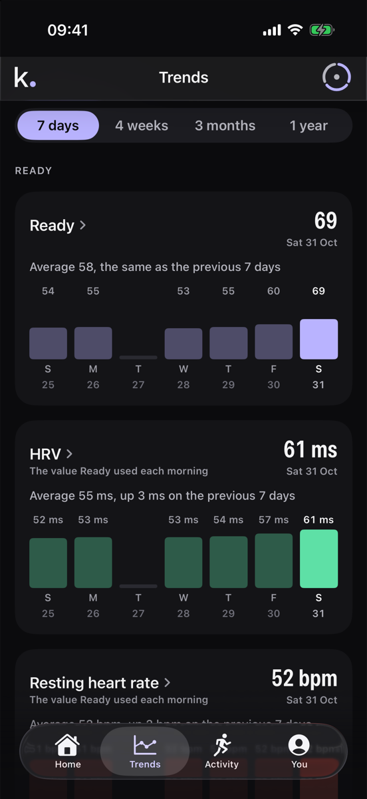
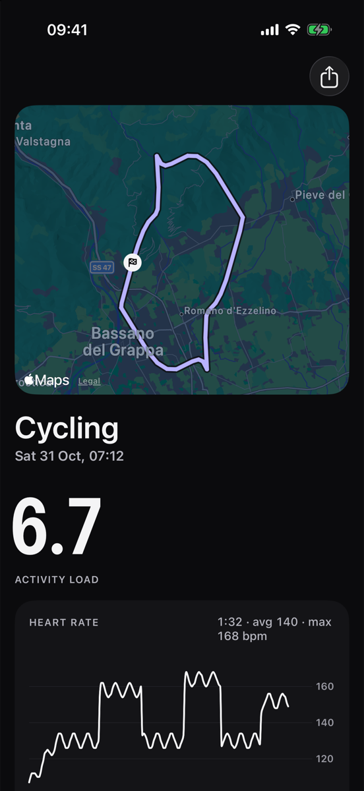
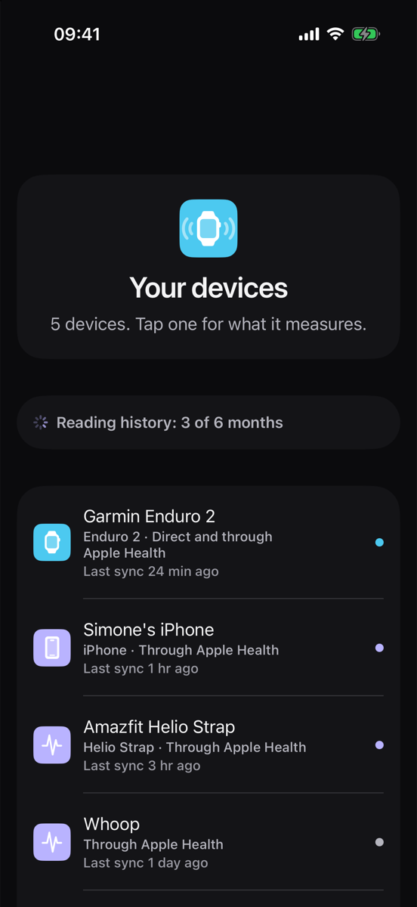

# Kinomia

Kinomia is one hub for all your wearables, and it's easy to use. It's an iPhone app that reads every device you own (a Garmin watch, a Garmin bike computer, an Amazfit Helio Strap, a Whoop, your iPhone) and gives you three numbers each morning: Ready, Load and Sleep. Your health data stays on your iPhone.

The screenshots run on made up data. The source code is private; this repository is a public overview.

## Contents

- [Why Kinomia](#why-kinomia)
- [What you get](#what-you-get)
- [Devices and services](#devices-and-services)
- [How the numbers work](#how-the-numbers-work)
- [How your data flows](#how-your-data-flows)
- [Architecture](#architecture)
- [Status and next steps](#status-and-next-steps)
- [Built so far](#built-so-far)

## Why Kinomia

People who train with more than one device live with four problems every day.

1. Activities don't reach Strava by themselves. You finish a ride and it isn't there.
2. Garmin Connect doesn't keep up. You finish an activity on your Garmin fēnix and it doesn't show up in the app. In Apple Health, Garmin Connect writes sleep at once, heart rate the next day and heart rate variability (HRV, the variation in time between heartbeats) never. On my own account it wrote no heart rate to Apple Health at all from December 2025 to October 2026.
3. Every device has its own app. A Garmin, an Amazfit Helio Strap and a Whoop mean three apps to open each morning, each with its own charts and its own names for the same thing.
4. Two devices that track the same night or the same workout give two different values, and you don't know which one to look at.

Kinomia puts every device in one app, organises the data by signal (heart rate, HRV, sleep, workouts) with the source written next to every reading, and combines the devices into one value per day.

## What you get

| Screen | What it does |
|---|---|
| Home | Ready, Load and Sleep as three dials, Vitals (how many of your night readings sit in your usual range), daytime stress so far, a daily outlook and today's activities. Arrows move back through past days. |
| Ready | Today against your last 30 days for HRV, resting heart rate, breathing rate and sleep, with one sentence such as "Ready 72, 10 above your usual 62". |
| Load | Time in heart rate zones 1 to 3 and 4 to 5, strength time and steps, with today's Load target. |
| Sleep | Stages, efficiency, consistency, bed and wake times, and the sleep you need tonight. |
| Trends | Every number over 7 days, 4 weeks, 3 months or 1 year. Each weekly bar can be tapped in place. |
| Activity | Every workout from every device, by days or weeks, with filters. A workout recorded by two devices shows once, with both recordings merged. Its page has the map, heart rate and the Load it added. |
| Devices | Each device, how it reaches Kinomia (through Apple Health or directly over Bluetooth), what it measures and when it last synced. |
| Journal and behaviors | A short daily log, and how each behavior went along with your Ready. |
| Weekly and monthly review | A summary of the last 7 or 30 days. |
| Share | Cards for Ready, Load, Sleep, a week, a workout or your devices, in seven color palettes, sized for a post or a story. |
| Routes | A Komoot tour becomes a course sent to your Garmin. |
| Desk | The iPhone serves a dashboard to a browser on your Mac on the same network, with no server in between. |

## Devices and services

| Device or service | How it reaches Kinomia | Status |
|---|---|---|
| Garmin Enduro 2 and other Garmin watches | Through Apple Health from Garmin Connect, and from a Garmin Connect account export for older history | In daily use |
| Garmin Edge 540 | Directly over Bluetooth (Direct mode) | Built, not yet tested on the hardware |
| Amazfit Helio Strap | Through Apple Health from Zepp; directly over Bluetooth | Apple Health in daily use; Direct mode built, not yet tested |
| Whoop | Through Apple Health and from a Whoop export; directly over Bluetooth | Built; calibration starts when my Whoop arrives |
| iPhone | Apple Health | In daily use |
| Strava | Maps for your workouts; sending activities to Strava | Maps in daily use |
| Komoot | Planned tours turned into Garmin courses | Built, waits for tests on the Garmins |

Any other device that writes to Apple Health shows up too, with its name.

## How the numbers work

Every formula is versioned, and each change goes into a changelog that the app shows on its methods page.

| Number | Scale | What goes in |
|---|---|---|
| Ready | 0 to 100 | Last night's HRV, resting heart rate, breathing rate and Sleep score, each against your own 14 night average and 30 night spread. It needs 4 nights to start and reads as settled after 30 nights in 60 days. |
| Load | 0 to 21 | Heart rate reserve minutes weighted by intensity (a TRIMP, training impulse), on a curve fitted to two years of Whoop strain. Your maximum heart rate is learned from your workouts. |
| Sleep | 0 to 100 | How much of the sleep you needed you got, plus efficiency, consistency and calm. Your sleep need is learned from your last 28 nights and grows with a hard Load day and with sleep debt. |
| Daytime stress | 0 to 100 | How far your heart rate sat above rest during the day, outside sleep and workouts, against your last 60 days. It's context only and never part of Ready. |

Each device gets its own Ready, Load and Sleep. Kinomia's number combines them: each device's readings are compared with that device's own history, and the results are averaged. Nights count only from devices that recorded at least 4 hours asleep, and Load only from devices that saw at least 80% of the workout minutes. So the morning number is there as soon as one device has synced, and it can take the night from one device and heart rate and HRV from another.

Kinomia shows numbers for training and recovery. It isn't a medical device.

## How your data flows

1. Garmin Connect, Zepp and the other vendor apps write to Apple Health. Kinomia reads Apple Health app by app and device by device, after you agree to a health data consent.
2. In Direct mode Kinomia pairs with the device over Bluetooth, downloads its files and decodes them on the iPhone, with no vendor app involved.
3. Every reading lands in one SQLite database on the iPhone, one row per signal, source and day. Sources are never merged destructively: each keeps its own rows, and computed values are stored apart with their inputs.
4. The formulas run on the iPhone. The server holds only your email account.
5. Strava maps are fetched when you open a workout and kept for 48 hours at most, as Strava's API rules require.

You can export everything, erase everything, or delete your account from the app.

## Architecture

| Part | Language | What it does |
|---|---|---|
| iPhone app | SwiftUI | The screens, Apple Health reading, the on device database and Bluetooth. |
| `packages/core` | TypeScript | Every formula, written once. The iPhone runs it through JavaScriptCore, so the app and the server always compute the same numbers. |
| `packages/parsers` | TypeScript | Garmin, Zepp and Whoop exports, FIT, GPX and Komoot files. |
| Device protocols | Swift | Garmin, Zepp and Whoop over Bluetooth, written from protocol specifications, with attribution, and tested on Linux. |
| FIT decoder | Swift | Garmin's activity file format. |
| Sync and database | Swift, GRDB | The SQLite database on the iPhone, with the same table shapes as the server. |
| Backend | Supabase (Postgres) | Accounts, and an optional cloud copy that's closed for now. |
| Site | Static | [kinomia.app](https://kinomia.app) |

Shared test files (a "golden day" with known answers) pin the iPhone and the server to the same results, and a check fails the build if the JavaScript bundle on the iPhone drifts from the TypeScript source.

## Status and next steps

Kinomia runs on my own iPhone every day with a Garmin Enduro 2, a Garmin Edge 540 and an Amazfit Helio Strap.

1. Test Direct mode on the Garmin Edge 540, so Kinomia reads the Garmin without waiting for Garmin Connect.
2. Wear Garmin and Whoop together for 14 days to calibrate the Whoop readings.
3. Ship a first launch that asks for your goals and the Apple Health permissions.

## Built so far

I started on 4 October 2026 and I'm building it alone. In four weeks the private repository reached 799 commits and about 109,000 lines of Swift, TypeScript and SQL, with 462 test files across 14 Swift packages and 6 TypeScript packages.

Copyright 2026 Simone Lovera. All rights reserved.
